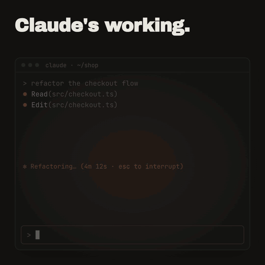

# Buddy

A pixel buddy for [Claude Code](https://code.claude.com) that lives in the band above your prompt. Pick a panda, a dino, a cat, a penguin, a frog, a ghost, a crab, a rubber duck, a snail, or a whole little forest. It reacts to what you and Claude are doing.



## Features

**It reacts to you**
- **You send a message:** it jumps and answers what you wrote in a speech bubble, in its own voice. Mention a bug and the cat goes "\*pounces\*"; ask the rubber duck a question and it asks you to explain it, line by line.
- **`/buddy poke`:** it does its signature move: the dino jumps, the panda curls up and rolls, the penguin belly-slides, the crab burrows and the snail hides in its shell.
- **`/buddy snack`:** snack time, a different one for each buddy (see below).

**It notices what Claude is doing**
- **Claude is working:** it runs back and forth, hopping on every tool call.
- **Claude finishes:** a happy double jump. The dino puts its shades on.
- **A `git commit` or `git push`:** confetti rains down, it jumps for joy and says "committed!" or "shipped!".
- **Claude asks you a question:** a "?" pops up and stays until you've answered.
- **A long wait:** if nothing happens for a while during Claude's turn, it yawns.
- **Something goes wrong:** an error or an interrupted turn upsets it. The snail hides in its shell and the duck's feathers ruffle.

**It has a life of its own**
- **Idle,** it wanders the band and now and then has a snack. The panda sits down with bamboo, the cat chases a mouse that runs in from the edge of the screen, and the frog watches a fly buzz about until it comes close enough to zap.
- **Nothing for a minute:** it dozes off. In the forest, night falls.
- **It remembers** which buddy you picked, and whether it's hidden, between sessions.

**It costs nothing**
- No model calls and no network requests: it's drawn locally from hand-made pixel art.
- It works in the terminal (half-block pixel art) and in the desktop app's Code tab (a crisp pixel sprite).

## The buddies


| Buddy | Moves | Instead of jumping | Snack |
| --- | --- | --- | --- |
| `panda` (default) | a slow, chill walk | curls into a ball and rolls | sits and eats bamboo, holding it in one paw |
| `dino` | a little run | jumps | none; it puts its shades on when Claude finishes |
| `cat` | a four-legged walk | jumps | a mouse runs in from the edge, then the chase is on |
| `penguin` | an upright waddle with a bob | belly-slides along the ice | chases a flopping fish |
| `frog` | hop-walks | leaps a body length | a fly buzzes about until it comes within reach, then the tongue zaps it |
| `ghost` | flies, its sheet trailing behind | floats up | spooks a bat it chases |
| `crab` | scuttles sideways | burrows into the sand, eyes peeking out | nibbles seaweed |
| `duck` | floats and bobs on the water | hops with a splash | dips for bread crumbs. It also answers your questions like any good debugging duck |
| `snail` | the slowest of all, leaving a slime trail | hides in its shell | nibbles a lettuce leaf |
| `forest` | a whole scene across the band: trees, a deer that runs through, a rabbit, butterflies | birds scatter from the trees | none; it rains when something fails, and night falls with fireflies when you're away |

## Install

Needs Claude Code v2.1.287 or later (the desktop app from v2.1.286).

```bash
claude plugin marketplace add rachhek/claude-plugins
claude plugin install buddy@rachhek
```

Then run `/reload-plugins` in an open session, or start a new one.

- **Update:** `claude plugin update buddy@rachhek`, then `/reload-plugins`
- **Remove:** `claude plugin uninstall buddy@rachhek`

## Commands

| Command | What it does |
| --- | --- |
| `/buddy` | Pick your buddy from a menu |
| `/buddy panda`, `dino`, `cat`, `penguin`, `frog`, `ghost`, `crab`, `duck`, `snail`, `forest` | Switch buddy (remembered between sessions) |
| `/buddy off`, `/buddy on` | Hide or show it |
| `/buddy poke` | Poke it: it does its move, a jump, a roll, a belly-slide, a burrow, or hiding in its shell |
| `/buddy snack` | Snack time: bamboo, a mouse, a fish, a fly, a bat, seaweed, crumbs or lettuce |

## How it works

Buddy is a Claude Code mod: a hooks module (`hooks/register.tsx`) that draws in the band above the prompt and listens for a few events: you sending a message, Claude starting and finishing a turn, and each tool call. From a tool call it only looks at the tool's name and, for shell commands, whether it's a `git commit` or `git push`. It runs ten frames a second and only redraws when the picture changes. Your choice of buddy, and whether it's hidden, are saved with the plugin, so they carry over between sessions.

## Troubleshooting

- **Nothing shows up:** run `/reload-plugins` or start a new session, and check it isn't hidden with `/buddy on`.
- **The colours look wrong or washed out:** buddy uses 24-bit colour, so use a terminal with truecolor support (most modern ones have it: iTerm2, Ghostty, kitty, WezTerm, Windows Terminal, VS Code). A dark theme suits it best.
- **The top of a buddy is cut off:** the band above the prompt has a limited height, so in a short terminal window the tallest moments (the frog mid-leap, the ghost flying high, the forest's treetops) can be clipped. A taller window helps.
- **Updated but nothing changed:** an open session keeps the version it loaded. Run `/reload-plugins` after updating.

## Develop

```bash
claude --plugin-dir plugins/buddy   # from the repo root: load it for one session, reloads on save
claude plugin validate plugins/buddy
claude plugin test plugins/buddy
npx -y -p typescript@5.6.3 tsc --noEmit -p plugins/buddy   # type check
```

Each buddy lives in its own file in `hooks/` (`panda.ts`, `dino.ts`, `cat.ts`, `penguin.ts`, `frog.ts`, `ghost.ts`, `crab.ts`, `duck.ts`, `snail.ts`, `forest.ts`), with shared drawing helpers in `hooks/shared.ts`. The engine is `hooks/register.tsx`, and the tests are in `tests/buddy.test.tsx`.

[AGENTS.md](AGENTS.md) has the rules for keeping the pixel art crisp, the art style, and what each character setting does. Read it before adding or changing a buddy. See [CONTRIBUTING.md](../../CONTRIBUTING.md) for how to send a change.

## Art

Every buddy is pixel art drawn by hand as rows of letters, one letter per pixel, in its own file. In the terminal each text cell shows two pixels stacked (half-block characters), and nothing is ever resized, so the art stays crisp. In the desktop app each pixel is a 6 px square.

| Buddy | Size (pixels) |
| --- | --- |
| dino | 14 × 10 |
| cat | 16 × 14 |
| ghost | 16 × 14 |
| panda | 17 × 17 sitting, 23 × 16 walking |
| frog | 18 × 14 |
| penguin | 19 × 17 |
| snail | 19 × 14 |
| crab | 20 × 12 |
| duck | 20 × 14 |
| forest | the full width of the band, 18 rows tall |

The panda's poses started from the pixel art in `art/panda.png` and were redrawn with a clean outline. All the characters are original; none is based on someone else's character.

## License

[MIT](LICENSE) © Rachhek Shrestha
