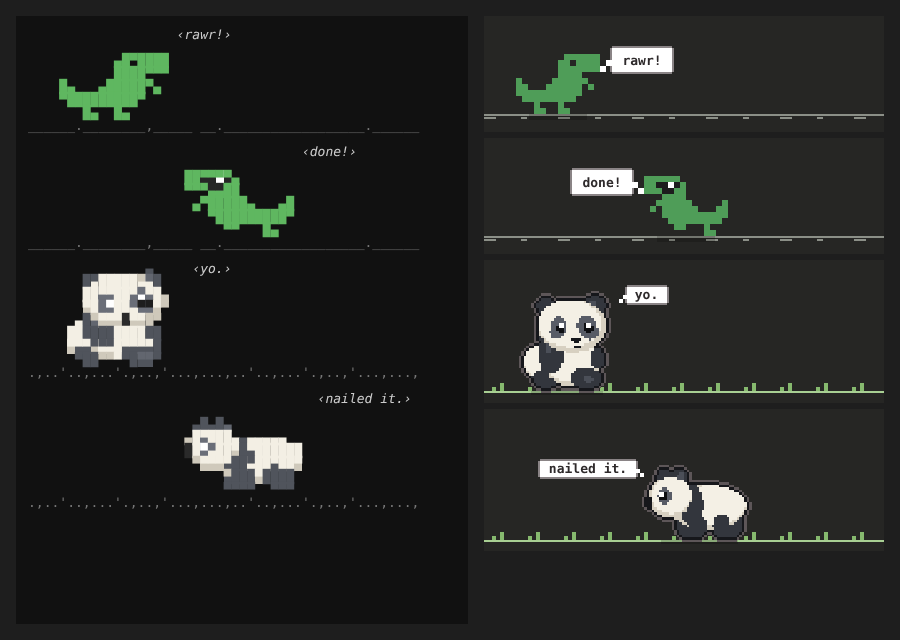

# Buddy

A pixel buddy for [Claude Code](https://code.claude.com): a dino or a panda that lives above your prompt.



- **You send a message:** it jumps and reacts to what you wrote
- **Claude is working:** it runs back and forth, hopping on each tool call
- **Claude finishes:** shades on, double jump
- **Idle:** it wanders (the panda sits down to munch bamboo)
- **Nothing for a minute:** it naps

Half-block pixel art in the terminal, a bigger pixel sprite in the desktop app's Code tab. It makes no model calls, so it costs nothing to run.

## Install

Needs Claude Code v2.1.287 or later (the desktop app from v2.1.286).

```bash
claude plugin marketplace add rachhek/claude-plugins
claude plugin install buddy@rachhek
```

To remove it: `claude plugin uninstall buddy@rachhek`.

Then run `/reload-plugins` in an open session, or start a new one.

## Commands

| Command | What it does |
| --- | --- |
| `/buddy` | Pick your buddy from a menu |
| `/buddy dino`, `/buddy panda` | Switch buddy (remembered between sessions) |
| `/buddy off`, `/buddy on` | Hide or show it |
| `/buddy jump` | Make it jump |
| `/buddy snack` | Give the panda some bamboo |
| `/buddy hd on\|off\|auto` | Draw a real picture instead of text blocks in terminals that can show images (Ghostty, kitty, WezTerm). `auto` (the default) turns it on when it detects one of those |

## Develop

```bash
claude --plugin-dir plugins/buddy   # from the repo root: load it for one session, reloads on save
claude plugin validate plugins/buddy
claude plugin test plugins/buddy
```

Characters live in `hooks/dino.ts` and `hooks/panda.ts`; the engine is `hooks/register.tsx`.

## Art

The panda's sitting and walking poses are pixel art in `art/` (facing right): `sit.png` (30 × 33) and `walk-1.png`, `walk-2.png` (50 × 22). They're read into `hooks/panda.ts` as the `SIT` and `WALK` rows. Blinking, sunglasses, chewing and the bamboo are drawn over the sitting pose in code. When it falls asleep it sits down, closes its eyes and snores.
